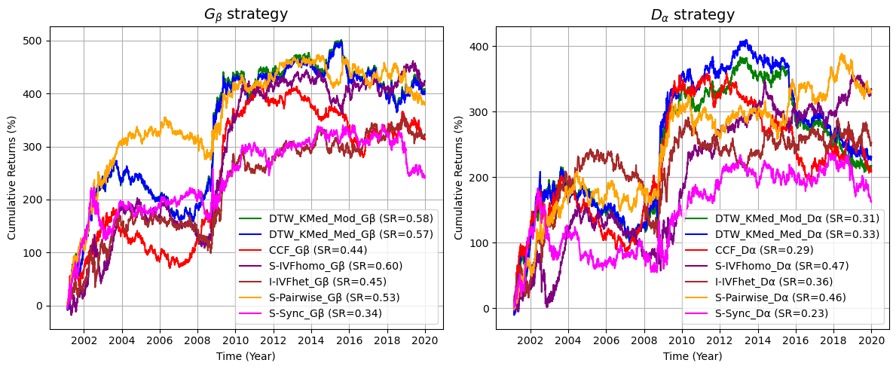
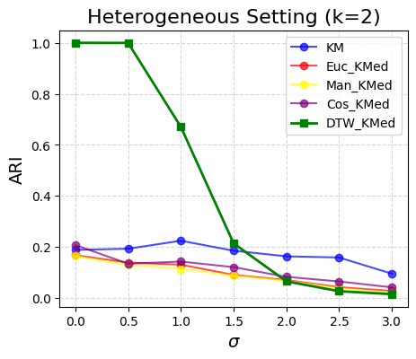
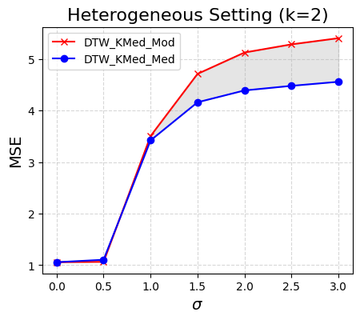
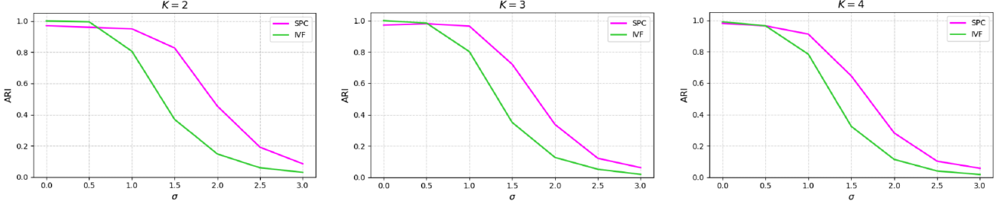

# Lead-lag detection for equity trading: DTW vs multireference alignment

Unsupervised detection of which U.S. stocks lead and which lag, using Dynamic Time Warping and multireference alignment, turned into a daily trading signal; the best model (S-IVFhomo) reaches a Sharpe ratio of 0.596 on 500 stocks over 2000-2019.



## The problem
Some assets react to common information earlier than others. If the leaders can be identified from recent returns alone, their moves can be used to forecast the laggards a few days ahead. The question is which unsupervised method recovers lead-lag structure most reliably in noisy, high-dimensional return panels, and whether that accuracy survives into a trading backtest.

## Approach
- **Synthetic benchmarks with known lags.**
  - DTW: 120 series (T = 100) from a lagged multi-factor model with 1 to 3 factors, Gaussian noise σ from 0 to 3, 100 runs per setting. Clustering scored with the Adjusted Rand Index (ARI), lag recovery with MSE against the true lead-lag matrix. DTW K-Medoids is compared with K-Means and with Euclidean, Manhattan and cosine K-Medoids; the DTW warping window is varied from 0 to 10.
  - MRA: K ∈ {2, 3, 4} latent signals (T = 50), 500 series with random cyclic shifts and noise, 100 runs per setting. Spectral clustering (SPC) vs invariant features with 1-NN (IVF), scored with ARI.
- **Real data preprocessing.** Daily returns of 500 U.S. equities: drop days with more than 10% zero returns and assets with more than 50%, compute excess returns over the S&P 500, winsorize to [-15%, +15%].
- **Lead-lag models.** On each rolling 21-day window (4,733 windows):
  - CCF: signed score from lagged cross-correlations (lags 1-5), as a baseline.
  - DTW_KMed_Mod / DTW_KMed_Med: K-Medoids with DTW distance (K = 5), then mode or median of the warping-path offsets for pairs in the same cluster.
  - S-Pairwise, S-Sync, S-IVFhomo: spectral clustering on maximum shifted correlations (lags up to 7), then pairwise lags, SVD synchronization, or lag to a per-cluster reference signal.
  - I-IVFhet: assignment to K random reference series by best shifted correlation.
- **Ranking and trading.** Row sums of the lead-lag matrix rank the assets; the top 25% are leaders. The signal is an exponentially weighted mean of the leaders' returns over the last 7 days. Gβ trades the laggards on the leaders' signal; Dα trades the leaders on their own signal (momentum). PnL is the sign of the signal times the basket's mean return 7 days ahead.
- **Evaluation.** PnL rescaled to 15% annualized volatility; Sharpe, Sortino and Calmar ratios and hit rate.

## Data
The data are **not included** in this repository. They are daily stock returns from CRSP, a licensed database that cannot be redistributed; the extract was provided by the thesis supervisor. The universe is the S&P 500 constituents over 2000-2019 (500 stocks). The step that builds `filtered_data.csv` from the raw extract is not part of the notebook, and the notebook only shows aggregated results: outputs that displayed security-level data were removed.

The notebook reads `filtered_data.csv` (long format, one row per stock and trading day) with these columns:

| Column | Type | Meaning |
|---|---|---|
| `PERMNO` | int | CRSP permanent security identifier |
| `date` | date (`YYYY-MM-DD`) | Trading day, 2000-01-03 to 2019-12-31 |
| `TICKER` | str | Ticker symbol (read but not used in the computations) |
| `RET` | float | Daily holding-period return |
| `sprtrn` | float | S&P 500 daily return on the same day |

After preprocessing, 270 days are removed (more than 10% zero returns), no asset is removed, and the final panel is 4,761 days × 500 assets.

## Key results
Backtest on 500 U.S. equities, 2000-2019, PnL rescaled to 15% annualized volatility (notebook, final comparison cell):

| Model | Gβ Sharpe | Gβ Sortino | Gβ Calmar | Gβ Hit rate | Dα Sharpe | Dα Sortino | Dα Calmar | Dα Hit rate |
|---|---|---|---|---|---|---|---|---|
| DTW_KMed_Mod | 0.576 | 0.864 | 0.164 | 0.509 | 0.306 | 0.454 | 0.066 | 0.500 |
| DTW_KMed_Med | 0.569 | 0.852 | 0.160 | 0.510 | 0.326 | 0.483 | 0.067 | 0.506 |
| CCF | 0.442 | 0.655 | 0.122 | 0.512 | 0.293 | 0.428 | 0.066 | 0.507 |
| S-IVFhomo | **0.596** | **0.872** | **0.238** | **0.514** | **0.470** | 0.675 | 0.175 | **0.520** |
| I-IVFhet | 0.453 | 0.664 | 0.196 | 0.513 | 0.356 | 0.518 | 0.100 | 0.503 |
| S-Pairwise | 0.533 | 0.791 | 0.213 | 0.508 | 0.463 | **0.676** | **0.251** | 0.509 |
| S-Sync | 0.339 | 0.484 | 0.127 | 0.507 | 0.229 | 0.330 | 0.067 | 0.497 |

- S-IVFhomo has the highest Sharpe ratio in both strategies (0.596 in Gβ, 0.470 in Dα). S-Pairwise has the best Calmar ratio in Dα (0.251).
- Both DTW variants beat the CCF baseline in Gβ (0.576 and 0.569 vs 0.442).
- Gβ (leaders forecast laggards) gives higher Sharpe ratios than Dα (momentum) for every model.
- The backtest ignores transaction costs and latency, uses fixed-size windows and assumes short-term stationarity.

Synthetic benchmarks. With two factors, DTW K-Medoids recovers the true clusters at low noise, where K-Means and K-Medoids with Euclidean, Manhattan or cosine distance do not; the advantage disappears as noise grows. For lag recovery, the median of the warping-path offsets gives a lower MSE than the mode once σ reaches 1.5, in all three factor settings.

 

For MRA clustering, spectral clustering keeps a higher ARI than IVF at intermediate noise levels for K = 2, 3 and 4:



## Stack
Python (Jupyter): NumPy, pandas, SciPy, scikit-learn, dtaidistance, pyclustering, joblib, tqdm, Matplotlib, seaborn.

## Run it
1. Create an environment (the notebook metadata records Python 3.12.4) and install dependencies:
   ```bash
   python -m venv .venv
   .venv/Scripts/activate        # Windows; use source .venv/bin/activate on Linux/macOS
   pip install -r requirements.txt jupyter
   ```
2. Place your own `filtered_data.csv` (schema above) in `notebooks/`. Without it, only the synthetic experiments (sections 1, 2, 7 and 8) can be run.
3. Open `notebooks/lead_lag_trading.ipynb` and run the cells in order. Intermediate results are written to `.pkl` files in the working directory and read back by later cells. The stored outputs show the cost: the DTW precomputation took 9:54:53 and the parallel CCF recomputation 20:48:31 (h:mm:ss) over the 4,733 windows.

## Repository structure
```
.
├── notebooks/
│   └── lead_lag_trading.ipynb   # full pipeline with stored outputs
├── figures/                     # PNGs used in this README
├── requirements.txt
├── LICENSE
└── README.md
```

## Context and authorship
- Built as the Master's thesis of the MSc in Big Data Analytics, Universidad Carlos III de Madrid (January-July 2025).
- Individual project.

## Author
**Juan del Mazo Vázquez** — [Website](https://juandelmazovazquez.vercel.app) · [LinkedIn](https://www.linkedin.com/in/juan-del-mazo-7500a7276) · [GitHub](https://github.com/JuandelMazoVazquez)

<details>
<summary>Resumen en español</summary>

Detección no supervisada de relaciones lead-lag entre 500 acciones estadounidenses (2000-2019) con Dynamic Time Warping y Multireference Alignment, validada primero con datos sintéticos de retardos conocidos. Las acciones se ordenan cada 21 días según la matriz lead-lag y las líderes generan la señal de trading. El mejor modelo, S-IVFhomo, obtiene un Sharpe de 0.596 en la estrategia Gβ y de 0.470 en Dα, por encima de la correlación cruzada (0.442 y 0.293).

</details>
